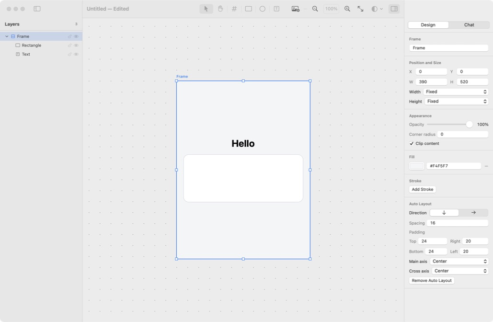
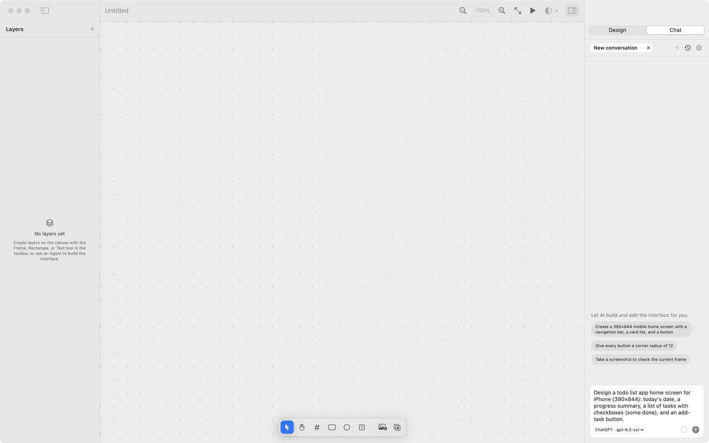
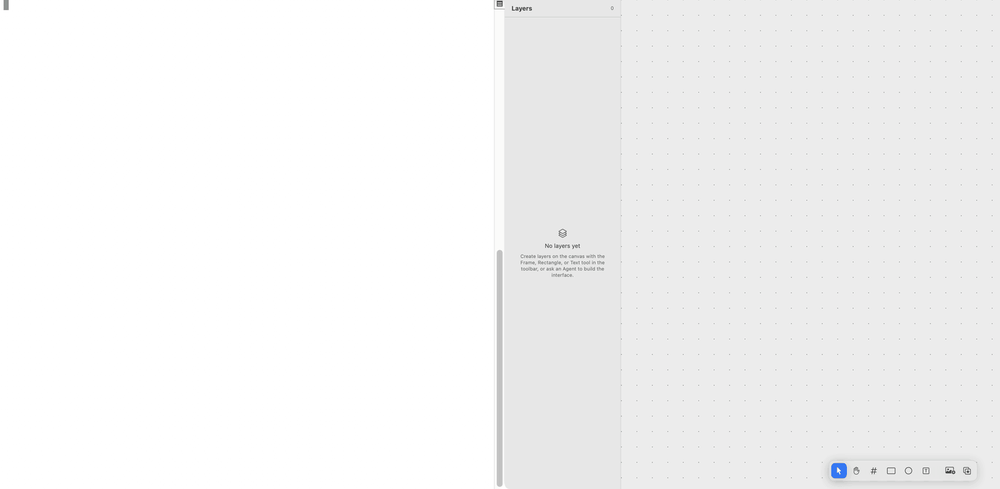

<p align="center">
  
</p>

<h1 align="center">Fudehand</h1>

<p align="center">
  A native macOS design tool where you and AI agents edit the same canvas.
</p>

<p align="center">
  English | <a href="README.zh-CN.md">简体中文</a>
</p>



Fudehand runs entirely on your own Mac. A design is a document made of layers, shown on a canvas you can pan and zoom, with Figma-style interaction. AI agents edit that same document through MCP or the in-app chat panel, and every change appears on the canvas immediately. Designs are saved as `.fudehand` project files, which are plain JSON.

The current version is v0.0.3; see the [CHANGELOG](CHANGELOG.md) for changes.

## See it in action

Both clips make the same request: a todo list app home screen for iPhone, with today's date, a progress summary, a task list with checkboxes, and an add-task button. They are sped up.

### From the chat panel

Type the request in the *Chat* tab on the right of the editor; the model builds the screen on the canvas while it replies.



### From Claude Code over MCP

With the `fudehand` MCP server connected, Claude Code builds the screen in the open document, checks a snapshot, and fixes what it finds.



## Highlights

- **Native canvas.** A SwiftUI + AppKit app that renders layers directly with Core Animation. There is no web view and no web server.
- **One document for people and agents.** The App is the sole owner of the design document. Your edits and an agent's edits go through the same editor and share one undo history.
- **Design tools for agents.** An MCP server lets Claude Code, Codex, DeepSeek Harness, or any MCP client read, create, and change layers, then take a snapshot to check the result.
- **Built-in chat panel.** Ask a model to build or change the UI from inside the App, using DeepSeek, Claude, or ChatGPT with your own API key (ChatGPT needs an OpenAI API key).
- **Open file format.** `.fudehand` files are versioned JSON that you can read, diff, and keep in Git.
- **Four UI languages.** US English (the default), British English, Simplified Chinese, and Traditional Chinese.

## Requirements

- macOS 14 or later
- Swift 6 or later (the Xcode Command Line Tools are enough; full Xcode is not needed)
- Node.js 22.12 or later
- pnpm 11.7.0

Node is used only for the MCP server and the Agent harness behind the chat panel. The App has no third-party Swift dependencies.

## Quick start

There is no prebuilt installer; build the App from source on your own Mac.

```bash
pnpm install
pnpm build:native        # release build with ad-hoc signing → dist/Fudehand.app
open dist/Fudehand.app
```

You can drag `dist/Fudehand.app` into the Applications folder. Keep this checkout, though: the chat panel and the MCP connector use the source directory the App was built from.

## Using the App

The App opens on the launch window, where you can:

- create a new design document (⌘N),
- open a project file (⌘O),
- continue a file from *Recent*, or
- start from a built-in template.

In the editor, use the tools in the toolbar at the bottom of the canvas to create layers: Frame (F), Rectangle (R), Ellipse (O), and Text (T). Arrange layers in the layers panel on the left, and edit position, size, fill, stroke, text, and auto layout in the *Design* tab on the right.

To change the UI language, choose *Fudehand → Language*. The choice applies immediately and is remembered across launches.

The [macOS guide](docs/macos.md) covers canvas interaction, panels, files, and keyboard shortcuts in full.

## Working with AI agents

Agents work through a set of design tools that the MCP server and the in-app chat panel share. Every tool call is forwarded to the running App, so the App must be open; otherwise a tool returns `Fudehand is not running`.

### Connect an agent

The quickest way is *Fudehand → MCP Connector…*. It shows whether Claude Code, Codex, and DeepSeek Harness are connected, and *Connect* registers this checkout's MCP server in that agent's user-level configuration (through `claude mcp add --scope user` or `codex mcp add`; for DeepSeek Harness, by adding a marked block to `~/.dsh/cordis.patch.yml`, leaving the rest of that file untouched). *Disconnect* removes the registration. An agent that is not installed is shown as unavailable. A new connection takes effect in agent sessions opened afterwards.

You can also set it up by hand:

- **Claude Code.** The `.mcp.json` at the repository root already registers `fudehand`. Start `claude` from the repository root and approve the project MCP server when asked; it then appears in `/mcp`.
- **Codex.** Run `codex mcp add fudehand -- node /path/to/fudehand/scripts/mcp-server.mjs`, or add this to `~/.codex/config.toml`, using the absolute path of this checkout:

  ```toml
  [mcp_servers.fudehand]
  command = "node"
  args = ["/path/to/fudehand/scripts/mcp-server.mjs"]
  ```

  Codex asks for approval before every MCP tool call, and rejects the call outright in unattended modes such as `codex exec`. To skip approval, add `default_tools_approval_mode = "approve"` to the block above. Write tools change the design document directly, so enable this only when you need it.

- **DeepSeek Harness.** Add this entry to `~/.dsh/cordis.patch.yml` (the patch list every profile applies; create the file if it does not exist), using absolute paths — the desktop app does not inherit your shell's `PATH`, so `node` alone may not be found. The MCP Connectors window only recognizes the block it wrote itself, so do not also use *Connect* after adding the entry by hand:

  ```yaml
  - insert:
      - id: mcp-fudehand
        name: "@deepseek-ai/dsh-mcp-client"
        config:
          serverName: fudehand
          transport: stdio
          command: "/path/to/node"
          args: ["/path/to/fudehand/scripts/mcp-server.mjs"]
  ```

The MCP server uses the repository that contains the script. Append `--root <directory>` to point it at another checkout.

### Tools

| Group | Tools | Notes |
| --- | --- | --- |
| Read | `design_get_state`, `design_get_document`, `design_get_node` | The state is an overview: file, selection, undo availability, and top-level layers. |
| Edit | `design_create_node`, `design_update_node`, `design_delete_nodes`, `design_move_node`, `design_select`, `design_undo`, `design_redo` | Each call is one undo step and updates the canvas immediately. |
| File | `design_new_document`, `design_open_document`, `design_save_document` | New and open are refused while there are unsaved changes, unless you pass `discard: true`. |
| Viewport | `canvas_focus_node`, `canvas_fit_all`, `canvas_zoom` | |
| Check | `design_snapshot` | Returns a PNG of the actual rendering. |

A few details worth knowing:

- `design_create_node` can create a whole subtree at once through `children`.
- `design_update_node` is a partial patch: nested objects are merged field by field.
- A field error explains what is wrong and leaves the document unchanged.
- For an image, pass `image.path` (a local PNG, JPEG, or SVG) and the tool reads the file for you. An SVG is kept as vector source, so icons stay sharp at any zoom. One request is limited to 32 MB, which leaves room for about 24 MB of image files.
- For an icon, call `design_search_icons` to find a name such as `lucide/house` or `sf/house.fill`, then create a layer with `type: "icon"` and `icon: { name, color }`. Icons come from four built-in libraries — SF Symbols, Material Symbols (outlined, rounded, sharp), WeUI, and Lucide — and stay sharp at any zoom.
- In file and image paths, `~` expands to your home directory.

The tools reach the App through its control channel, a Unix socket at `~/Library/Application Support/fudehand/control.sock` (override it with `FUDEHAND_CONTROL_SOCKET`). It is open only to the current user and does not listen on any network address.

### Chat panel

Open the *Chat* tab of the inspector (⇧⌘A) to have a model build or change the UI directly. Each tool call and its result is shown in the panel and can be expanded. You can stop a reply while it is in progress; no further tool calls run after that.

In *Model Settings*, every model provider is listed with its own key, base URL, and model; enter an API key for a provider, test it with *Test*, and press *Use for Chat* to make it the one the chat uses (the model menu under the input also switches between providers that have a key). Changes apply when you press *Save*. ChatGPT needs an OpenAI API key; a ChatGPT subscription does not include one.

| Model provider | API | Default base URL | Default model |
| --- | --- | --- | --- |
| DeepSeek | OpenAI-compatible | `https://api.deepseek.com` | `deepseek-chat` |
| Claude | Messages API | `https://api.anthropic.com` | `claude-sonnet-5-5` |
| ChatGPT | Responses API | `https://api.openai.com/v1` | `gpt-5.3-codex` |

Leave *Model* and *Base URL* empty to use the defaults above. For another service that is compatible with OpenAI Chat Completions, choose DeepSeek and enter your own base URL and model name.

Claude and ChatGPT receive the image that `design_snapshot` returns, so the model can look at its own work. The OpenAI-compatible API cannot carry an image in a tool result, so with DeepSeek the model is told the image was left out and checks its changes by reading the layers back instead.

The API key is stored only in your local Keychain (service name `fudehand.agent`). The App passes it to the chat program through an environment variable, and never writes it to the repository, project files, preferences, or logs.

## Project files

*File → Save* (⌘S) and *Save As…* (⇧⌘S) write a design to a `.fudehand` project file; *Open…* (⌘O) and *Open Recent* reopen it. The App registers the `.fudehand` file type, so double-clicking a file in Finder, dragging it onto the Dock icon, or choosing *Open With* opens it in Fudehand. If the current document has unsaved changes, the App asks whether to save them first.

A design document is a tree of layers: frames, rectangles, ellipses, text, images, icons, and groups. Layers have fill, stroke, corner radius, opacity, visibility, and lock; frames can also use auto layout. A project file is JSON with a format version number:

```json
{
  "format": "fudehand.design",
  "version": 5,
  "nodes": [
    { "id": "home", "type": "frame", "name": "Home", "x": 0, "y": 0, "width": 390, "height": 844, "fill": "#FFFFFF",
      "layout": { "direction": "vertical", "spacing": 12, "padding": { "top": 16, "right": 16, "bottom": 16, "left": 16 },
                  "align": "start", "crossAlign": "stretch" },
      "children": [
        { "id": "title", "type": "text", "name": "Title", "x": 16, "y": 16, "width": 358, "height": 30,
          "text": { "content": "Today", "fontSize": 24, "fontWeight": 700, "color": "#111111", "align": "left", "autoResize": "height" } }
      ] }
  ]
}
```

Coordinates are relative to the parent layer. Array order is stacking order, with later items on top. The saved geometry is the result after auto layout. For every field and validation rule, see the [design document spec](docs/superpowers/specs/2026-11-17-native-design-document-design.md) and [ADR 0006](docs/adr/0006-native-design-document.md).

Fudehand does not import or export Figma files.

## Development

```bash
pnpm dev               # debug build, then open the App
pnpm build:native      # release build with ad-hoc signing → dist/Fudehand.app
pnpm test:native       # Swift tests: FudehandCoreTests and FudehandAppTests
pnpm bench:native      # canvas drag, hover, and layer selection benchmarks on large documents (release build)
pnpm check             # Vitest: MCP tools, MCP server, and chat harness
pnpm mcp               # start the MCP server over stdio (an agent usually launches it)
```

The Node tests start child processes and local sockets, so they need loopback networking. A sandbox that forbids listening on local ports makes them fail spuriously.

The repository is laid out like this:

| Path | Contents |
| --- | --- |
| `native/Sources/FudehandCore/` | Document model, validation, auto layout, edit history, interaction rules, and the control protocol. No AppKit dependency. |
| `native/Sources/FudehandApp/` | The SwiftUI shell, canvas rendering, layers and properties panels, chat panel, and control channel. |
| `native/Tests/` | Swift tests. |
| `scripts/` | Native build and test scripts, the MCP server, the Agent harness, and the shared design tools. |
| `tests/` | Node tests (Vitest). |
| `docs/` | The macOS guide, architecture decision records, and specs. |

Read the [contributing guide](CONTRIBUTING.md) before you open a pull request.

### Releasing

The release steps are in the [contributing guide](CONTRIBUTING.md#releasing). The version number lives in two places, and one command keeps them in step:

```bash
pnpm version:set X.Y.Z   # set the version in package.json and Info.plist; bump the build number (CFBundleVersion) by 1
pnpm version:check       # check that every location agrees; otherwise list the differences and exit non-zero
```

- `package.json` is the version the MCP server reports; it is read at runtime.
- `native/Resources/Info.plist` is the version shown in the App's About window.

## Documentation

- [macOS guide](docs/macos.md): canvas interaction, panels, files, and shortcuts
- [GLOSSARY](GLOSSARY.md): the project's terms
- [ADR 0003](docs/adr/0003-agent-mcp.md): MCP, the control channel, and the chat panel
- [ADR 0006](docs/adr/0006-native-design-document.md): the native design document
- [Agent tools](docs/agent-tools.md) and [ADR 0007](docs/adr/0007-agent-parity.md): every App feature is an Agent tool
- [ADR 0008](docs/adr/0008-style-library-tools-run-in-node.md) and [style library](styles/README.md): reference styles the Agent reads when you name one
- [CHANGELOG](CHANGELOG.md) and [contributing guide](CONTRIBUTING.md)

## License

Fudehand is released under the [Apache-2.0 license](LICENSE). The source is hosted on [GitHub](https://github.com/Bald-M/fudehand). The App is built and run only on your own machine; there is no CI, cloud sync, or production deployment.

The Agent's design guidance in `scripts/design-guidance.mjs` is adapted from the `frontend-design` skill in [anthropics/skills](https://github.com/anthropics/skills/tree/main/skills/frontend-design), Copyright Anthropic, PBC, licensed under Apache-2.0. Its design principles and self-review checklist are adapted from [Trystan-SA/claude-design-system-prompt](https://github.com/Trystan-SA/claude-design-system-prompt), Copyright (c) 2026 Trystan Sarrade, licensed under MIT; that repository is a community reconstruction of the Claude Design system prompt, not Anthropic's original text. The file keeps the MIT notice and lists what was changed.
