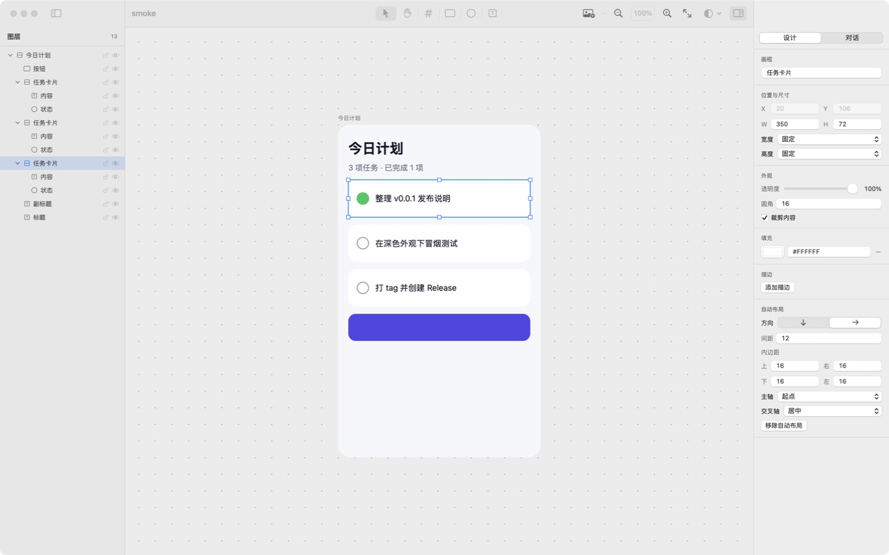

<p align="center">
  
</p>

<h1 align="center">Fudehand</h1>

<p align="center">
  原生 macOS 设计工具，你和 AI Agent 在同一块画布上编辑。
</p>

<p align="center">
  <a href="README.md">English</a> | 简体中文
</p>



Fudehand 完全运行在你自己的 Mac 上。设计稿是一份由图层组成的文档，显示在可平移、可缩放的画布上，交互参照 Figma。AI Agent 通过 MCP 或 App 内的对话面板编辑同一份文档，每次修改都立即显示在画布上。设计稿保存为 `.fudehand` 工程文件，内容是普通 JSON。

当前版本 v0.0.3，变更记录见 [CHANGELOG](CHANGELOG.md)（英文）。

## 特点

- **原生画布。** SwiftUI + AppKit 应用，用 Core Animation 直接渲染图层，没有 web view，也不依赖网页服务。
- **人和 Agent 共用一份文档。** App 是设计文档的唯一持有者。你的修改和 Agent 的修改走同一个编辑器，共用一条撤销历史。
- **给 Agent 用的设计工具。** Claude Code、Codex 或任何 MCP 客户端都能通过 MCP server 读取、创建和修改图层，再截图核对结果。
- **内置对话面板。** 在 App 里直接让模型搭建或修改界面，支持 DeepSeek、Claude 和 ChatGPT，使用你自己的 API key（ChatGPT 需要 OpenAI API key）。
- **公开的文件格式。** `.fudehand` 是带版本号的 JSON，可以直接阅读、对比，也可以放进 Git。
- **四种界面语言。** 美式英语（默认）、英式英语、简体中文和繁体中文。

## 环境要求

- macOS 14 或更高版本
- Swift 6 或更高版本（Xcode Command Line Tools 即可，不需要完整 Xcode）
- Node.js 22.12 或更高版本
- pnpm 11.7.0

Node 只用于 MCP server 和对话面板背后的 Agent harness。App 没有第三方 Swift 依赖。

## 快速开始

没有预编译安装包，需要在自己的 Mac 上从源码构建。

```bash
pnpm install
pnpm build:native        # Release 构建并 ad-hoc 签名 → dist/Fudehand.app
open dist/Fudehand.app
```

`dist/Fudehand.app` 可以拖进“应用程序”文件夹。但请保留本检出目录：对话面板和 MCP 连接器要用到构建时的源码目录。

## 使用 App

App 启动后先显示启动窗口，在这里可以：

- 新建设计文档（⌘N）；
- 打开工程文件（⌘O）；
- 从“最近打开”继续上次的文件；
- 从自带模板开始。

进入编辑后，用画布底部工具栏的工具在画布上创建图层：画框（F）、矩形（R）、椭圆（O）、文字（T）。在左侧的图层面板里整理图层，在右侧的“设计”标签里修改位置、尺寸、填充、描边、文字和自动布局。

界面语言默认是美式英语。在应用菜单的 *Fudehand → Language*（语言）里切换，选择立即生效，并保留到下次启动。下文的菜单和按钮名称都按简体中文界面来写。

画布操作、面板、文件和快捷键的完整说明见 [macOS 使用说明](docs/macos.md)（英文）。

## 接入 AI Agent

Agent 通过一组设计工具工作，MCP server 和 App 内的对话面板共用这组工具。每次工具调用都转发给运行中的 App，所以 App 必须开着；否则工具返回 `Fudehand is not running`。

### 连接 Agent

最快的方式是应用菜单的 *Fudehand → MCP 连接器…*。窗口里显示 Claude Code 和 Codex 是否已连接；点“连接”，App 会把本检出目录的 MCP server 注册到该 Agent 的用户级配置里（通过 `claude mcp add --scope user` 或 `codex mcp add`），点“断开连接”则移除注册。本机没有安装对应 CLI 的 Agent 会显示为不可用。新建立的连接在之后打开的 Agent 会话中生效。

也可以手动配置：

- **Claude Code。** 仓库根目录的 `.mcp.json` 已经注册了 `fudehand`。在仓库根目录启动 `claude`，按提示同意启用项目 MCP server，之后就能在 `/mcp` 里看到它。
- **Codex。** 运行 `codex mcp add fudehand -- node /path/to/fudehand/scripts/mcp-server.mjs`，或者把下面这段加到 `~/.codex/config.toml`，路径换成本检出目录的绝对路径：

  ```toml
  [mcp_servers.fudehand]
  command = "node"
  args = ["/path/to/fudehand/scripts/mcp-server.mjs"]
  ```

  Codex 默认在每次 MCP 工具调用前询问审批，在 `codex exec` 这类无人值守模式下会直接拒绝调用。要跳过审批，在上面的配置块里加一行 `default_tools_approval_mode = "approve"`。写入类工具会直接修改设计文档，请只在需要时开启。

MCP server 默认使用脚本所在的仓库。追加 `--root <目录>` 可以让它指向另一个检出目录。

### 工具

| 分组 | 工具 | 说明 |
| --- | --- | --- |
| 读取 | `design_get_state`、`design_get_document`、`design_get_node` | state 是概览：文件、选区、能否撤销，以及顶层图层摘要。 |
| 编辑 | `design_create_node`、`design_update_node`、`design_delete_nodes`、`design_move_node`、`design_select`、`design_undo`、`design_redo` | 每次调用是一步撤销，画布立即更新。 |
| 文件 | `design_new_document`、`design_open_document`、`design_save_document` | 有未保存修改时，新建和打开会被拒绝，除非传 `discard: true`。 |
| 视口 | `canvas_focus_node`、`canvas_fit_all`、`canvas_zoom` | |
| 核对 | `design_snapshot` | 返回实际渲染结果的 PNG。 |

几个值得知道的细节：

- `design_create_node` 可以通过 `children` 一次创建整棵子树。
- `design_update_node` 是局部修改：嵌套对象按字段合并。
- 字段有误时会说明原因（英文），文档保持不变。
- 插入图片时传 `image.path`（本地 PNG 或 JPEG），工具会替你读取文件。单次请求上限 32 MB，大约可以放下 24 MB 的图片文件。
- 文件路径和图片路径里的 `~` 会展开为你的主目录。

工具通过 App 的控制通道与 App 通信。控制通道是一个 Unix socket，位于 `~/Library/Application Support/fudehand/control.sock`（可用 `FUDEHAND_CONTROL_SOCKET` 覆盖）。它只对当前用户开放，不监听任何网络地址。

### 对话面板

打开右侧检查器的“对话”标签（⇧⌘A），就可以直接让模型搭建或修改界面。每次工具调用及其结果都显示在面板里，可以展开查看。回复进行中可以随时停止，停止后不会再执行工具调用。

在“模型设置”里，每个模型提供方都单独列出，各有自己的 key、接口地址和模型；为某个提供方填入 API key，用“测试”检查它，再按“用于对话”让对话使用它（输入框下方的模型菜单也能在已有 key 的提供方之间切换）。修改在按下“保存”后生效。ChatGPT 需要 OpenAI API key；ChatGPT 订阅不包含 API key。

| 模型提供方 | 接口 | 默认接口地址 | 默认模型 |
| --- | --- | --- | --- |
| DeepSeek | OpenAI 兼容 | `https://api.deepseek.com` | `deepseek-chat` |
| Claude | Messages API | `https://api.anthropic.com` | `claude-sonnet-5-5` |
| ChatGPT | Responses API | `https://api.openai.com/v1` | `gpt-5.3-codex` |

“模型”和“接口地址”留空时使用上表的默认值。其他兼容 OpenAI Chat Completions 的服务，请选择 DeepSeek，再填入自己的接口地址和模型名。

Claude 和 ChatGPT 能收到 `design_snapshot` 返回的图片，模型可以看到自己做出来的效果。OpenAI 兼容接口的工具结果无法携带图片，所以使用 DeepSeek 时，模型会被告知图片已省略，改为读回图层数据来检查修改。

API key 只保存在本机钥匙串里（服务名 `fudehand.agent`）。App 通过环境变量把它传给对话程序，不会写入仓库、工程文件、偏好设置或日志。

## 工程文件

用“文件”菜单的“保存”（⌘S）和“另存为…”（⇧⌘S）把设计稿存为 `.fudehand` 工程文件，用“打开…”（⌘O）或“打开最近”重新打开。App 注册了 `.fudehand` 文件类型，所以在 Finder 里双击文件、把文件拖到 Dock 图标上，或选择“打开方式”，都会用 Fudehand 打开。当前文档有未保存修改时，App 会先询问是否保存。

设计文档是一棵图层树，包含画框、矩形、椭圆、文字、图片和分组。图层有填充、描边、圆角、透明度、显示/隐藏和锁定；画框还可以使用自动布局。工程文件是带格式版本号的 JSON：

```json
{
  "format": "fudehand.design",
  "version": 1,
  "nodes": [
    { "id": "home", "type": "frame", "name": "首页", "x": 0, "y": 0, "width": 390, "height": 844, "fill": "#FFFFFF",
      "layout": { "direction": "vertical", "spacing": 12, "padding": { "top": 16, "right": 16, "bottom": 16, "left": 16 },
                  "align": "start", "crossAlign": "stretch" },
      "children": [
        { "id": "title", "type": "text", "name": "标题", "x": 16, "y": 16, "width": 358, "height": 30,
          "text": { "content": "今日计划", "fontSize": 24, "fontWeight": 700, "color": "#111111", "align": "left", "autoResize": "height" } }
      ] }
  ]
}
```

坐标相对于父图层。数组顺序就是叠放顺序，靠后的在上层。保存的是自动布局计算之后的几何结果。全部字段和校验规则见[设计文档规格](docs/superpowers/specs/2026-11-17-native-design-document-design.md)和 [ADR 0006](docs/adr/0006-native-design-document.md)（均为英文）。

Fudehand 不能导入或导出 Figma 文件。

## 开发

```bash
pnpm dev               # Debug 构建并打开 App
pnpm build:native      # Release 构建并 ad-hoc 签名 → dist/Fudehand.app
pnpm test:native       # Swift 测试：FudehandCoreTests 与 FudehandAppTests
pnpm bench:native      # 大文档下的画布拖动与悬停基准（release 构建）
pnpm check             # Vitest：MCP 工具、MCP server 与对话 harness
pnpm mcp               # 以 stdio 启动 MCP server（通常由 Agent 拉起）
```

Node 测试会启动子进程和本地 socket，需要本机回环网络。禁止监听本地端口的沙箱会让它们误报失败。

仓库的目录结构：

| 路径 | 内容 |
| --- | --- |
| `native/Sources/FudehandCore/` | 文档模型、校验、自动布局、编辑历史、交互规则和控制协议。不依赖 AppKit。 |
| `native/Sources/FudehandApp/` | SwiftUI 外壳、画布渲染、图层面板与属性面板、对话面板和控制通道。 |
| `native/Tests/` | Swift 测试。 |
| `scripts/` | 原生构建与测试脚本、MCP server、Agent harness，以及共用的设计工具。 |
| `tests/` | Node 测试（Vitest）。 |
| `docs/` | macOS 使用说明、架构决策记录和规格文档。 |

提交 pull request 之前，请先阅读[贡献指南](CONTRIBUTING.md)（英文）。

### 发布

发布步骤写在[贡献指南](CONTRIBUTING.md#releasing)里。版本号存在两处，用一条命令保持一致：

```bash
pnpm version:set X.Y.Z   # 改写 package.json 与 Info.plist 的版本号，构建号（CFBundleVersion）加 1
pnpm version:check       # 检查各处版本号一致，不一致时列出差异并以非 0 退出
```

- `package.json` 里的是 MCP server 上报的版本，运行时读取。
- `native/Resources/Info.plist` 里的是 App“关于”窗口显示的版本。

## 文档

- [macOS 使用说明](docs/macos.md)：画布操作、面板、文件和快捷键
- [GLOSSARY](GLOSSARY.md)：项目术语
- [ADR 0003](docs/adr/0003-agent-mcp.md)：MCP、控制通道与对话面板
- [ADR 0006](docs/adr/0006-native-design-document.md)：原生设计文档
- [CHANGELOG](CHANGELOG.md) 与[贡献指南](CONTRIBUTING.md)

以上文档均为英文。

## 许可

Fudehand 以 [Apache-2.0 许可证](LICENSE)发布，源码托管在 [GitHub](https://github.com/Bald-M/fudehand)。App 只在你自己的机器上构建和运行，没有 CI、云同步或生产部署。

`scripts/design-guidance.mjs` 中的 Agent 设计指引改写自 [anthropics/skills](https://github.com/anthropics/skills/tree/main/skills/frontend-design) 的 `frontend-design` skill（版权归 Anthropic, PBC 所有，Apache-2.0 许可）；其中的设计原则和自评清单改写自 [Trystan-SA/claude-design-system-prompt](https://github.com/Trystan-SA/claude-design-system-prompt)（Copyright (c) 2026 Trystan Sarrade，MIT 许可），该仓库是社区还原的 Claude Design 系统提示词，并非 Anthropic 官方原文。该文件内保留了 MIT 许可声明，并注明了改动内容。
